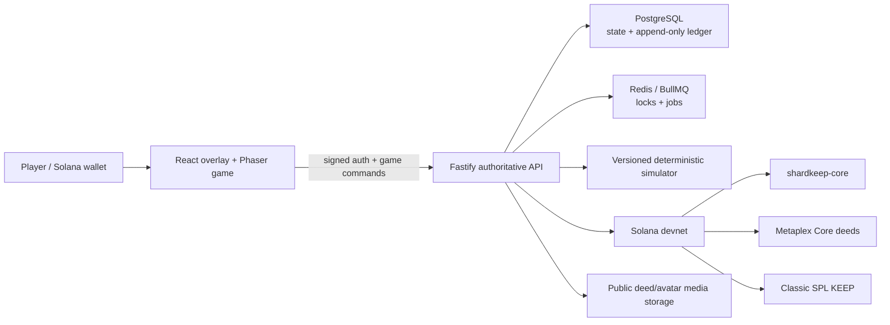

# Pixel Kingdom Wars architecture

**Current scope:** live, open Solana-devnet playtest. `SHARDKEEP` is the repository/program codename; Pixel Kingdom Wars is the product name.

This document describes the architecture implemented in the current codebase. Historical plans and GDD extracts explain why decisions were made, but current code and verified chain state are authoritative when old prose differs.

## 1. Design principles

1. **The server is authoritative.** The client renders state and submits intent. Costs, ownership, gates, timers, collision, custody, and settlement are rechecked by the API.
2. **Use Solana where public ownership or settlement matters.** Wallet signatures, SOL payments, SPL transfers, Land Deeds, and liabilities commitments are on-chain; fast-changing game state is not.
3. **Combat is deterministic and versioned.** A fixed-tick pure simulator produces the same result for the same frozen input. Historical playback uses archived authoritative events.
4. **A deed owns a playable base.** Base-local progression and SHARDS follow the Metaplex Core asset; wallet identity, KEEP/SOL, clans, and account-wide cosmetics stay wallet-scoped.
5. **Every gameplay number has one home.** `packages/shared/src/constants.ts` is the sole source for tunables shared across API, simulator, and client.
6. **Operational failure stops value movement.** Missing chain proof, stale ownership, insufficient reserve, mismatched signer/config, or ambiguous finality fails closed.

## 2. System context



The public game deployment serves web and API from one origin. The product site is a separate Cloudflare Pages deployment. Most pages are static; narrowly routed Pages Functions provide current leaderboard, campaign and activity data in initial semantic HTML on `/leaderboard` and `/campaigns`, including their trailing-slash aliases. The Functions and browser refresh use the same escaped renderer and uncredentialed public JSON endpoints. The published Android store app is a Trusted Web Activity around the same production origin. The private native Android candidate uses Kotlin, Jetpack Compose and libGDX with the same authoritative production API. Native battle presentation and versioned purchase receipts are enabled; its original package and signing certificate support an in-place update. Physical Seeker acceptance and the owner's manual store publication remain separate.

## 3. Repository boundaries

| Path | Responsibility |
|---|---|
| `apps/web` | Vite 8, React 19 overlay, Phaser 4 world/battle rendering, wallet/mobile integration, service worker |
| `apps/api` | Fastify 5 API, authorization, authoritative game rules, persistence, custody, jobs, chain observers |
| `packages/shared` | types, schemas, and canonical game constants; large map datasets use subpath exports |
| `packages/sim` | pure deterministic combat and replay protocol |
| `packages/chain` | program instruction builders, SPL operations, Metaplex Core deeds, chain verification helpers |
| `programs` | Anchor workspace containing exactly two custom programs |
| `scripts` | art/audio pipeline, release checks, devnet/token/deed operations, economic models |
| `infra` | local dependencies, production compose/deployment, public address registry, backup/restore tooling |
| `landing` | public product and legal site |
| `art/source` and versioned `art/` collections | immutable source deliveries consumed by the asset manifest/pipeline |

## 4. Client architecture

### React and Phaser

React owns authentication, navigation, sheets, HUD, inventory/economy screens, social features, and accessible form controls. Phaser owns the zoomable base, actors, particles, and battle playback; a separate Canvas renderer owns the fantasy globe today; D-186 replaces it on the web with the lazy WebGL2 world (flat globe and realm maps, behind `VITE_FEATURE_WORLD_V2` and the shared `worldV2.enabled` capability), and the Canvas globe stays as its no-WebGL2 fallback. A small event boundary connects the two; neither client layer becomes authoritative for a game mutation.

The base scene renders a 30×30 plot with a centered, expandable claim and outer deployment ring. Building selection and drag use stored logical footprints, asset metadata anchors, and server-confirmed layouts. WORLD presents the versioned fantasy globe: eight realms, 85,414 fixed deed tiles and 32 permanently non-owned exploration islands. One persisted location resolver supplies parcel detail, ownership markers, scouting and terrain context. The full base ground and surroundings share the realm's versioned terrain; decorative animation cannot change placement or collision.

The isolated integrated candidate adds an explicit optional plot contract:
missing/1 retains[0,30), while2 permits[-10,40) without shifting any stored
coordinates. Live responses derive the contract from current claim bounds;
archived snapshots retain their recorded version. The owner-approved September16
progression appends sequential purchases through50×50; its costs and Keep gates
live only in canonical CAPS. The isolated candidate exercises those purchases
through an explicit zero-charge transport. SIM15 battlefieldVersion2 independently spans
[-34,64), allowing empty cells while frozen occupied footprints stay blocked.
The historical30plot constant and legacy simulation branch remain unchanged.

Battle presentation consumes the server's archived event timeline. Sprites interpolate between deterministic event positions, while health bars, projectiles, ability effects, and audio remain presentation. The browser does not settle combat.

### Viewport and asset readiness

A fixed application root follows the browser's dynamic viewport. Drawable terrain
fills that root; any conservative host-toolbar clearance applies to controls
separately. Phaser explicitly remeasures its parent before refreshing canvas size
on initial readiness, resize and resume. The globe retains pointer ownership for
map gestures, including gestures starting on keep markers.

Scenes remain covered until the correct realm terrain and contextual walls are
ready. Asset caches are keyed by release/art generation and verify hashes before
use. Bounded loading recovery distinguishes useful byte progress from idle time,
pauses deadlines while hidden, and rejects mismatched generations. First-attempt
diagnostics survive a later failed retry without recording asset contents or
player input.

### State and network

- TanStack Query holds server state and refetch boundaries.
- Zustand/local UI state handles transient navigation and presentation.
- Wallet Adapter/Wallet Standard and Solana Mobile Wallet Adapter expose wallet connections.
- Privy can create an embedded Solana wallet for social/email onboarding; the wallet still signs the server challenge.
- Same-origin production cookies are httpOnly; mutations use authenticated API calls and server-side base resolution.

### Performance boundary

The initial web bundle has a hard 1,000 KB gzip ceiling enforced by `apps/web/scripts/size-check.mjs`. Data-heavy world modules remain subpath exports and lazy presentation chunks must not leak through a barrel into first paint. Runtime media is packaged separately from JavaScript.

## 5. API and data model

### Authentication and admission

Authentication is wallet control:

1. the API issues a nonce/context challenge;
2. the wallet signs it;
3. the API verifies the Ed25519 signature and creates an httpOnly session.

Embedded-wallet login joins the same signature flow. Admission is separate from session creation. With the explicit `PLAYTEST_OPEN` setting enabled, any authenticated player can enter normal onboarding without an invite, application, Seeker verification or `alpha_access` record. Wallet authentication, session revocation, admin authorization and gameplay/deed requirements remain enforced. Existing internal-wallet lists retain their analytics and campaign exclusion roles independently of open admission.

Referral links are processed through `/referrals/use` after authentication, with optional manual entry in Profile. Missing, invalid or failed referral attribution never blocks play; existing qualification rules and benefits remain unchanged. Public applications and invite issuance are retired while explicit open playtest is enabled, with historical records preserved. The legacy gated-admission paths remain available when configured.

### Wallet scope and base scope

`players` represents wallet identity. `bases` represents the transferable unit of play. Active base slots bind a wallet session to stable bases, and every base-owned table keys back to `base_id`.

Base-scoped state includes structures, layouts, jobs, builders, expansions, SHARDS, Mine buffers, Forge positions, army/research, heroes/loadouts, inventory, shields, trophies, quests, and battle history. Wallet-scoped state includes KEEP/SOL custody, authentication, deposits/withdrawals, clan membership, referrals, and account-wide cosmetics.

Fresh deed authority is an authorization dependency. Ownership observers read confirmed Metaplex Core state, store the observation context, and reject privileged changes when proof is stale, missing, or changed. A transfer rebases the complete playable base onto the new wallet after chain ownership is observed.

### Persistence and transactions

PostgreSQL is the durable source for gameplay and custody. Drizzle migrations are forward-applied. Redis/BullMQ coordinates scheduled work and bounded locks but is not the ledger of record.

Custodial KEEP/SOL accounting is append-only double-entry:

- ledger transactions carry unique idempotency keys;
- entries sum to zero and record resulting balances;
- corrections use compensating entries rather than history edits;
- chain writes use durable intent/outbox state so retries cannot grant twice.

Business mutations that spend value, change ownership-sensitive state, or settle a raid execute within database transactions and recheck the relevant lock/version.

The production topology can use separate non-owner database logins for the public API and worker while retaining one PostgreSQL instance. The schema owner is reserved for drained migration/recovery jobs. Database grants and triggers let the API insert the player's raw withdrawal proof while keeping worker-validated authorization fields, hot-wallet transaction artifacts, payout-allowance reservations, and settlement evidence outside the API role's authority; mainnet configuration refuses the legacy owner-credential mode.

Before gameplay bootstrap, API and worker startup assert one immutable database economy identity: cluster, KEEP mint, core program, and Config PDA. A mismatch refuses service. A nonempty legacy database can bind automatically only to the known devnet registry, so moving balances to mainnet requires a fresh database or an explicit drained owner migration.

Before signing, the worker reserves each gross request amount against a worker-only rolling-24-hour allowance for that wallet, then finalizes or releases the reservation with terminal chain evidence. A separate database-blind policy signer owns the hot key and an append-only, fsynced artifact journal. It independently validates the exact KEEP transfer and enforces per-transfer, per-wallet rolling-24-hour, and aggregate rolling-24-hour custody ceilings before returning signed bytes. The aggregate ceiling is a security circuit breaker, not a player allowance or tokenomics rule. This bounds a multi-wallet API/database compromise without claiming that the signer has independently proven gameplay entitlement.

### Jobs

Worker/scheduler responsibilities include deposit reconciliation, withdrawal payout, deed mint/recovery, deed metadata and chain-URI synchronization, Mine/Forge settlement, quest/league cadence, mail expiry, ownership observation, proof-of-liabilities publication, and integrity monitoring. Exactly one production worker owns schedulers.

When the optional worker path is unavailable, only explicitly designed fallback ticks run in the API process. Value paths never infer success from a missing worker.

## 6. Combat and replays

`packages/sim` has no I/O. It receives a frozen snapshot, accepted orders, and seed, then returns a result and deterministic events.

Key invariants:

- 100 ms fixed tick;
- integer positions at 256 units per tile;
- seeded PRNG and stable actor ordering;
- no wall clock, `Math.random`, or transcendental `Math` functions;
- checked/guarded resource and loot settlement;
- behavior changes move `SIM_VERSION` and justified golden fixtures.

### Live raid flow

1. The API selects a base and exposes only approximate loot ranges.
2. Raid creation locks the defender base and freezes layout, economy, army, heroes/gear, rules version, and seed.
3. Player deployments arrive as append-only commands with canonical timestamps and validation.
4. The server resolves the pinned simulator version and settles idempotently.
5. The immutable event timeline and participant history are archived for playback.

This avoids both client cheating and replay drift. A newer UI may draw an archived event more beautifully, but it cannot change the stored outcome.

## 7. Solana boundary

Detailed accounts, instructions, program IDs, and verified current state are in [SOLANA.md](SOLANA.md).

### Custom programs

- **`shardkeep-core` (active):** configured SOL routing, entry/repeatable payment receipts, legacy sequential receipts, pause/two-step admin, and immutable epoch liability roots.
- **`shardkeep-distributor` (inactive):** deployed one-claim Merkle distribution program for a future TGE simulation. Its current-mint PDA is absent, initialization is restricted to the program's current upgrade authority, and it has no production call sites or funds.

Neither program stores base layouts, SHARDS, troops, quests, raids, or marketplace listings.

### Land Deeds

Land Deeds use Metaplex Core, not Bubblegum. A Core asset is tied to one stable base, has dynamic metadata, a permanent freeze delegate, and an asset-level copy of the collection's 5% marketplace-honoured royalty. Trading is currently enabled.

Each assigned deed's public place is its persistent fantasy world/tile claim, with `Location`, `Realm` and `Tile` metadata traits. The approved migration placed legitimate active deeds in central Crownlands and held locations for legitimate inactive deeds, excluding positively identified retired assets. Assigned locations survive transfer and deactivation. Original Earth bindings remain private for reconciliation and recovery; retired documents and URIs are excluded from fantasy publication.

Native acquisitions use explicit fantasy addresses and held/assigned/released claims, with unique live tile/base bindings. The durable cutover rejects new Earth-only quotes while preserving recovery of already-issued legacy payment intents. Solana's 2,000 Genesis and 3,582 Seeker allocations remain reserved, and exploration islands are never deed-eligible. Once native claims exist, an Earth-only binary is not a safe rollback target. These are the D-128/D-129 contracts; no relocation, region buffs or allocation grants are enabled.

The deed collection screen links to external markets. After a Core transfer, the buyer claims the base and the server re-reads ownership before rebinding it; there is no custom deed escrow program. The separate in-game item market uses authoritative listings and verifies a direct atomic SOL split between seller and fee treasury.

### KEEP and liabilities

The current Classic SPL devnet mint has 500 million KEEP and retains mint/freeze authority during alpha. That is the current fact; the earlier one-billion/revoked-authority design is not.

The API verifies finalized token deposits and submits withdrawals through the configured worker signer. New withdrawals require the player's wallet signature over one canonical intent: selected Solana cluster and KEEP mint, gross amount, 2% fee, net amount, destination, idempotency key, standard/instant mode, and unbonding period. The proof and escrow freeze are persisted together. Before signing a payout, the worker independently verifies the wallet signature, the session at the database-authored submission time, the frozen network, the immutable request fields, and the exact two-entry ledger freeze.

The hot wallet policy signer creates one recent-blockhash transaction. Its signature, exact signed wire bytes, validity horizon, and decoded economic snapshot are committed before any RPC broadcast. Retries rebroadcast those same bytes to every configured economy RPC. Mainnet requires two independent providers and a two-provider quorum for finalized success or error. Null history after blockhash expiry is never treated as proof that a transfer did not land, because ordinary RPC providers may prune finalized history; that state remains held and non-refundable until archival or operator evidence resolves it. This removes the lost-ack double-send window without requiring a durable nonce. The implemented boundary is still a software service with a file-backed key, not an HSM or enclave; mainnet key custody and operational ceilings require separate approval.

Weekly custody liabilities are Merkle-committed through `shardkeep-core::post_root`. `/por` publishes reserve/root data and user proofs, while the game UI does not yet provide a proof screen.

Reserve coverage counts only the canonical Classic SPL KEEP ATA controlled by the configured hot wallet after finalized validation of its program owner, mint, authority, account state, exact balance, and lack of delegation. Generic treasuries, liquidity pools, unrelated holdings, frozen accounts, and encumbered balances do not qualify. Mainnet requires two independent economy RPC providers and exact agreement on the economic custody evidence before a payout can proceed.

## 8. Economy authority

SHARDS and KEEP are distinct:

- **SHARDS** are base/deed-local soft currency stored in the authoritative database.
- **KEEP** is wallet-level Classic SPL/custodial value on devnet.
- **SOL** payments are player-signed and chain-verified before the server grants an effect.

Mines create collectable SHARDS buffers. PvP settles exact deed-local loot from a frozen economic snapshot. The Gold Forge is the only SHARDS-to-KEEP gameplay faucet and splits a bounded daily pool across eligible deed positions. In-game KEEP sinks recycle to the emission pool except the withdrawal fee.

All prices, caps, timing curves, drop rates, and combat stats remain in shared constants. The API is the enforcement point even when the client uses the same constant to display a quote.

See [ECONOMY.md](ECONOMY.md) for the current playtest reward budget, token flows, fees, prices, and progression curves. Those values are live playtest settings and may be retuned for in-game economy optimization; the off-chain emission pool is not the inactive distributor program.

## 9. Asset and audio architecture

Original SVG/PNG/WAV/MP3 deliveries are source inputs, not runtime folders. The private asset pipeline resolves the active manifest and intentional collisions, rasterizes SVG with Resvg/Sharp, packs Phaser atlases and metadata, validates approved audio provenance, and writes generated output under `apps/web/public/{atlas,audio,brand}`.

Generated output under `apps/web/public/{atlas,audio,brand}` is committed in this repository. Runtime paths and asset IDs are compatibility-sensitive: pack names, tier/frame indices, anchors, scale, and direction are verified before an art source is promoted.

The audio runtime separates normal-world and battle music and bounds mobile decoding/voices. Generated SFX enter the approved master set only through a hash-bound provenance/review pipeline; they are never hand-promoted into runtime output.

## 10. Deployment and mobile

Production uses containerized PostgreSQL, Redis, API, worker, and a single-origin web proxy on the game host. Deploy tooling applies migrations, builds the matching web/API release, checks health/version, and verifies ledger/deed/reserve invariants. The landing site deploys separately.

The Android app is a Bubblewrap-generated signed Trusted Web Activity pointing at the production origin. Web and mobile therefore share game code and protocol. The APK, AAB, keystore, and signing-password material are local release artifacts and must never be tracked or included in Docker context.

Backup tooling creates validated archives and SHA-256 sidecars, can upload to an authenticated off-host target, reads the remote object back to verify its exact size and hash, and supports a remote-download scratch restore with schema and ledger-integrity checks. It refuses local-only backup mode on mainnet. The production host still needs an external provider and credentials, immutable/versioned retention, an installed schedule with alerts, and a successful live remote restore drill before mainnet.

## 11. Security invariants

### Program checklist

Every change under `programs/` must preserve:

- release overflow checks and checked arithmetic;
- signer requirements on every authority;
- typed accounts with owner/discriminator checks;
- canonical, distinct PDA seeds and bumps;
- `init` rather than reinitializable state unless a reviewed migration demands otherwise;
- treasury/token mint/authority constraints;
- typed SPL CPIs and no unvalidated remaining accounts;
- multiply-before-divide basis-point math;
- events for value movement;
- adversarial tests for wrong signers/accounts, duplicate actions, forged Merkle proofs, node-as-leaf attempts, windows, and pause bypass.

### Backend checklist

Custody and deed changes additionally require idempotency, exact chain evidence, fresh authority, row/transaction locking, fail-closed config, reserve checks, bounded retries, and an explicit recovery story. Mainnet requires deployment and verification of the isolated runtime-role mode, a signer-level loss policy independent of API-authored entitlement, a reviewed fresh-ledger or devnet-to-mainnet migration ceremony, and an independent security review of the complete program and backend release.

No third-party audit has been completed.

## 12. Verification gates

GitHub CI runs workspace typecheck, lint, tests, build, and the simulator-version comparison. API tests use real PostgreSQL and Redis services. Anchor validator tests are a separate mandatory manual/release gate and are not yet a CI job.

```bash
docker compose -f infra/docker-compose.yml up -d
pnpm -r typecheck
pnpm -r lint
pnpm -r test
pnpm -r build

cd programs
anchor build
anchor test
```

See [TESTING.md](TESTING.md) for package-specific evidence and [KNOWN_LIMITATIONS.md](KNOWN_LIMITATIONS.md) for the public gap list.

## 13. Current boundaries

- Gameplay is server-authoritative rather than fully on-chain.
- The distributor is deployed but inactive and is not a live rewards system.
- The devnet KEEP mint retains its authorities; final mainnet supply policy is unresolved.
- Land Deed royalties depend on marketplace support and are not enforced on every direct transfer.
- Program assurance currently consists of internal review and adversarial tests; no third-party audit has been completed.
- The Android build has been submitted to the Solana dApp Store and remains under review.
- Clan persistence exists, while playable clan warfare remains unavailable.
- Mainnet has no deployed program, mint, collection, PDA state, or reviewed public address registry in this repository.
- Source implements wallet-bound withdrawal intents, durable pre-broadcast artifacts, two-provider reconciliation, strict liquid-custody PoR, and isolated database-role support; production provisioning, independent review, HSM/enclave policy enforcement, off-host recovery, and physical-device verification remain prerequisites for mainnet.
- Withdrawal proofs and the singleton database economy identity bind cluster, mint, core program, and Config PDA; mainnet still requires a reviewed fresh-ledger or migration ceremony rather than repointing devnet balances.

These boundaries define the current devnet-playtest architecture.
