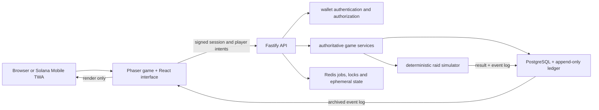
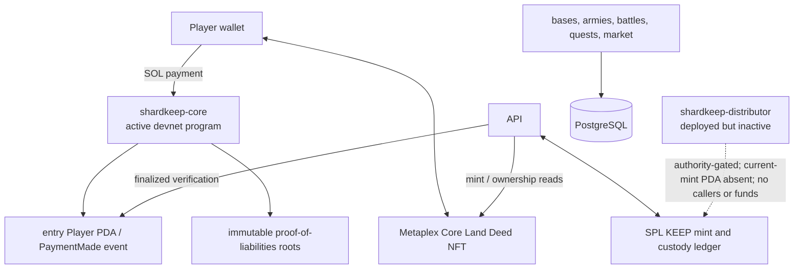
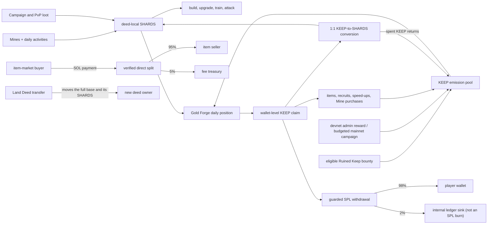
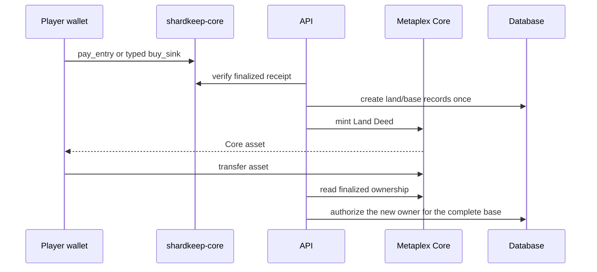

# Architecture and game-flow diagrams

These diagrams show the current devnet-alpha architecture and value flows.
See [`ARCHITECTURE.md`](ARCHITECTURE.md) for the detailed boundary and
[`GAMEPLAY.md`](GAMEPLAY.md) for mechanics.

## Request and battle flow

The server validates costs, timers, ownership and battle inputs. New battles are
resolved by `packages/sim`; a replay renders the stored result rather than
running historical inputs under current simulator rules.

## Solana boundary

The two custom Anchor programs do not hold the base map, armies or combat. The
Core program records payments and weekly liability commitments. Land Deeds use
Metaplex Core, not Bubblegum. The distributor is prepared for a future Merkle
distribution but is not an active player rail.

## Player economy and market flows

## Land purchase and transfer

