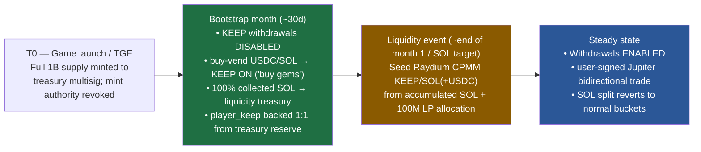
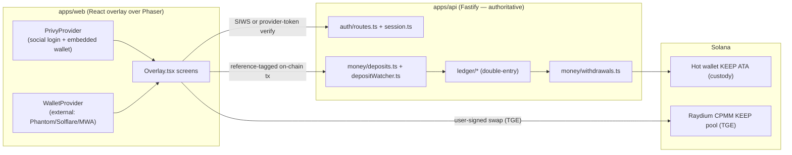
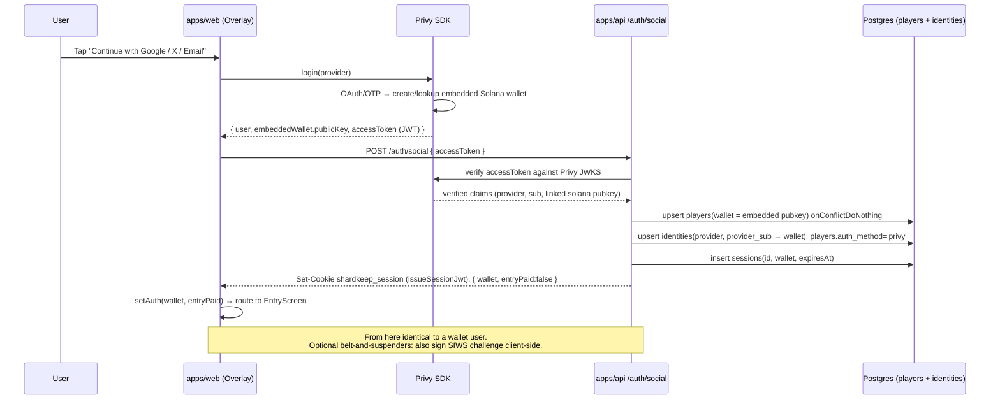
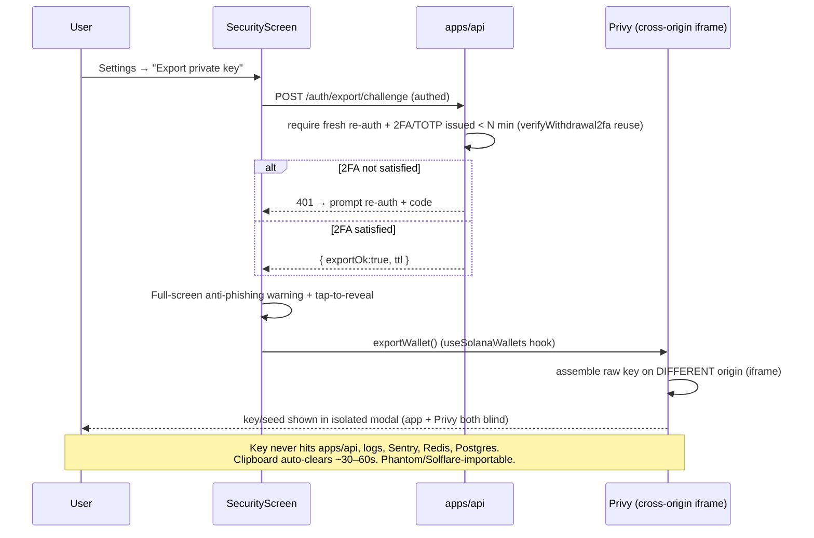
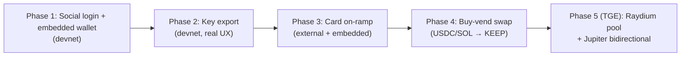

# SHARDKEEP — Accounts, Key Export, Card On-Ramp & Native Swap: Implementation Plan

> **Historical design plan, not a mainnet-readiness statement.** Its fixed-supply
> and “mainnet day-one” language records an earlier target model. Current chain
> facts, implemented safeguards, and remaining activation prerequisites are in
> [SOLANA.md](SOLANA.md), [SECURITY.md](../SECURITY.md), and
> [KNOWN_LIMITATIONS.md](KNOWN_LIMITATIONS.md).

**Status:** implementation-ready build plan · **Target:** devnet alpha now, mainnet day-one · **Author:** lead architect
**Authority note:** all game numbers referenced here live (or must be added) ONLY in `packages/shared/src/constants.ts`; server stays authoritative; secrets in `infra/keys/` per project hard rules.

---

## 1. Executive Summary

The four requested capabilities slot into SHARDKEEP with **surprisingly little disruption to the core custody model**, because two existing facts do the heavy lifting:

1. **The session layer is identity-agnostic.** `auth/session.ts` issues an HS256 JWT whose only claim is `sub = <wallet base58>`. `DEV_LOGIN` already proves a valid session can be minted from a pubkey *with no signature*. A social-login route is a hardened, production version of that same pattern.
2. **The deposit watcher is wallet-agnostic.** `money/deposits.ts` + `depositWatcher.ts` credit the ledger from a reference-tagged, finalized, idempotent on-chain payment made by **any** Solana wallet. An embedded wallet or an external wallet are indistinguishable to it. So **card → wallet → existing deposit flow** works unchanged; we do **not** build a new "card → ledger credit" path (that would break Proof-of-Reserves).

### Recommended stack (one line each)

| Layer | Choice | One-line rationale |
|---|---|---|
| **Embedded wallet** | **Privy** (alt: Coinbase CDP) | Only CONFIRMED provider with Google+X+email **and** safest self-service Solana key export (cross-origin assembly, Phantom-importable). |
| **On-ramp** | **Onramper** aggregator → **USDC-on-Solana** | One integration serves embedded **and** external wallets non-custodially, 180+ countries; provider is merchant-of-record (no PCI/chargeback on us). |
| **Swap (KEEP-model-conditioned)** | **Buy-only treasury vend** during bootstrap → **Jupiter-on-Raydium-CPMM** at the liquidity event | Decided bootstrap model (§2): no-liquidity "buy gems" for the first month; withdrawals + user-signed bidirectional DEX turn on once the SOL-seeded pool is live. |
| **Identity/schema** | Keep pubkey PK + `identities` table + `auth_method` | Zero FK churn; matches "the wallet IS the identity". |
| **Compliance** | Non-custodial keys + licensed MoR on-ramp + user-signed swaps | Keeps SHARDKEEP out of FinCEN MSB / MiCA CASP scope. |

### The one hard guardrail

> **Every `player_keep` credit must be backed 1:1 by real KEEP entering the hot wallet** (`onchain_inflow −amt / player_keep +amt`), exactly as `keep_deposit` does today. A card payment that mints ledger KEEP without acquiring backing KEEP makes the ledger unbacked and `snapshot.ts` Proof-of-Reserves understate reserves. This is non-negotiable.

---

## 2. The KEEP token model — and why the swap design is conditioned on it

The codebase map + `constants.ts` are unambiguous that KEEP is **HYBRID**, split by phase:

| Dimension | Today (implemented) | Mainnet intent (designed, deferred) |
|---|---|---|
| Custody | Custodial off-chain double-entry ledger (`ledger/*`), hot-wallet-backed | Same play balance; withdrawable to self-custody |
| Market | **No DEX pool exists** (grep: zero Raydium/Orca/Jupiter/AMM) | DEX-liquid: `TOKEN.allocation.liquidity = 100_000_000` "10% TGE liquidity (LP burned)" |
| Price | No peg, no oracle, no managed rate (only `shardsPerKeep:1` internal identity) | Market-discovered on an AMM |
| SOL routing | `solSplitBps.liquidity = 4_000` + mine/expansion SOL 100% → liquidity wallet ("funds KEEP liquidity") | Seeds the KEEP/SOL pool at TGE |
| Token standard | Classic SPL, 9 decimals, 1B fixed, mint authority revoked at TGE | Jupiter/Raydium-routable by construction once liquidity exists |

**DECISION — RESOLVED (founder, 2026-07-23): DEX-liquid at TGE, with a one-month SOL-funded liquidity BOOTSTRAP during which withdrawals are disabled.** The launch is a *liquidity bootstrap financed by gameplay*:



- **T0 — TGE at (or before) game launch (recommended).** Full fixed supply minted to a treasury **Squads multisig**, mint authority revoked. TGE deliberately precedes DEX liquidity so real KEEP exists to back the custodial ledger, but **distribution (withdrawals) is gated off**.
- **Bootstrap month.** Players earn/buy KEEP into the custodial ledger but **cannot withdraw** — KEEP is an unambiguous in-game utility (lowest regulatory exposure while the game is newest). The **buy-vend is live**, so "buy KEEP instantly with a card" works day one. **100% of collected SOL routes to the liquidity treasury** instead of the normal `solSplitBps` buckets (bootstrap override lives in `constants.ts`).
- **Liquidity event (~end of month 1, or when a SOL target is hit).** Accumulated SOL + the earmarked 100M LP allocation seed a **Raydium CPMM KEEP/SOL (+KEEP/USDC) pool**. Then: flip the **`WITHDRAWALS_ENABLED`** gate on and front the pool with **user-signed Jupiter routing** for true bidirectional `SOL/USDC ↔ KEEP`. SOL split reverts to normal.

**The buy-vend (D1) is still the launch swap** — it is the only "buy KEEP" path that works before the pool exists. The DEX path (D2) turns on at the liquidity event, not before.

**Why not an operated treasury sell-desk (KEEP → SOL/USDC from our inventory)?** Because that is a FinCEN/MiCA **exchange / money-transmission red line** (§7). Buying is fine (buy-only vend); *selling* value back to users must be user-signed on-chain, never operated by us.

---

## 3. How the new pieces reconcile with the existing architecture

### 3.1 Where the embedded wallet sits

The embedded wallet lives in the **React overlay** (not Phaser). `PrivyProvider` wraps the app root in `apps/web/src/App.tsx`, above the existing `WalletProvider` (which stays for external Phantom/Solflare/MWA users). The embedded wallet exposes `publicKey` + `signMessage` + `signTransaction`, so it flows through the **existing SIWS path and the existing tx builders unchanged**.



### 3.2 Does the game balance stay custodial? **Yes.**

- **Auth key becomes NON-custodial** (this is the key insight): with Privy, the embedded private key is client-held (TEE/iframe), exportable, and never touches SHARDKEEP servers. So we do **not** flip to holding player signing keys — the worry in the codebase map about a "custody flip" is avoided by choosing an *exportable, client-side-signing* provider rather than a server-signer.
- **In-game KEEP stays custodial off-chain** exactly as today: `accounts` / `ledger_transactions` / `ledger_entries`, backed 1:1 by the hot-wallet KEEP ATA, weekly Merkle PoR via `snapshot.ts`. Nothing here changes.

### 3.3 How on-ramped funds reach the game

**Path: card → user's wallet → existing on-chain deposit → watcher credit.** No new deposit path, no new ledger primitive.

| Fund target | Concrete existing flow reused |
|---|---|
| Entry (0.2 SOL) | on-ramp SOL → `usePayEntry` → `pay_entry` → watcher stamps `entryPaidAt` |
| SOL sinks (energy/shield/mine/expansion/warzone) | on-ramp SOL → `useSolPurchase` → `buy_sink`/direct-to-liquidity → watcher |
| KEEP play balance | on-ramp USDC → **swap USDC→KEEP** → `keep_deposit` (SPL transfer to hot ATA) → watcher posts `onchain_inflow −/player_keep +` |

The KEEP path is the only one needing the new swap step. Everything else is already wired (`auth/useEntry.ts`, `auth/useSolPurchase.ts`, `auth/useKeepDeposit.ts`, `lib/chain.ts`).

### 3.4 File-level impact map

| Concern | Files touched | Change |
|---|---|---|
| Social login → session | `auth/routes.ts`, `auth/session.ts` | **Add** `POST /auth/social` (verify provider token, upsert identity+player, `issueSessionJwt` unchanged). `session.ts` unchanged. |
| Identity binding | `db/schema.ts` | **Add** `identities` table + `players.auth_method`. |
| Entry for empty wallet | `auth/useEntry.ts` (+ optional relayer) | On-ramp funds SOL; optional server fee-payer sponsorship. |
| Key export | web only (`ui/screens/`) | **Add** SecurityScreen "Export key" gated flow; no server route holds the key. |
| Card on-ramp | web (`ui/screens/`), `constants.ts`/env | **Add** on-ramp widget screen; server signs the destination address into the order. |
| Swap | `packages/chain/*`, `game/routes.ts`, web | **Add** treasury-vend client + (TGE) Jupiter quote/route; new swap route(s). |
| Deposit/ledger | `money/deposits.ts`, `ledger/*` | **No change** — reused as-is (PoR guardrail). |
| Withdrawals | `money/withdrawals.ts` | **No change** — the existing self-custody cash-out rail. |

---

## 4. The four core user flows (sequence diagrams)

### Flow A — Social/email signup → embedded wallet → session bridging



Notes: `POST /auth/social` is the hardened analog of `dev-login`. It reuses `issueSessionJwt` verbatim (identity-agnostic). It does **not** stamp `entryPaidAt` — the R9 entry gate stays real. We verify the *provider* token server-side rather than trusting a client claim. **Onboarding after login (decided):** the fresh embedded wallet is empty, so EntryScreen shows a **quick explainer of what to do** → prompts **"Fund your wallet"** (card → SOL via the on-ramp, Flow C) → then **pay the 0.2 SOL entry** → **create base**. No sponsored gas for MVP.

### Flow B — Private-key export (security-gated)



The server's only role is to **gate** export (fresh re-auth + 2FA) — it never sees the key. This reuses the existing `twofa.ts` machinery (TOTP / verified-email OTP, lockout, single-use). CI grep blocks any server-side `privateKey|secretKey|mnemonic|seed` handling.

### Flow C — Card on-ramp (BOTH embedded and external wallet users)

```mermaid
sequenceDiagram
    participant U as User
    participant Web as apps/web
    participant API as apps/api
    participant OR as Onramper (MoR provider)
    participant Chain as Solana
    participant DEP as depositWatcher

    U->>Web: "Buy with card" (embedded OR external wallet connected)
    Web->>API: POST /onramp/session { walletAddr, target: 'sol' | 'keep' }
    API->>API: OFAC/geo check; sign destination addr into order (anti-redirect)
    API-->>Web: { onramperUrl/params, orderId }
    Web->>OR: open widget (Apple/Google Pay/card)
    OR->>OR: KYC + PCI + card capture (provider is merchant-of-record)
    OR->>Chain: deliver USDC-on-Solana (or SOL) to walletAddr
    OR-->>API: webhook: settled (idempotent on provider event id)

    alt target = SOL (entry / sinks)
        Web->>Chain: existing pay_entry / buy_sink tx (user signs)
        Chain-->>DEP: reference-tagged, finalized
        DEP->>API: creditDeposit (entry → entryPaidAt, etc.) — UNCHANGED
    else target = KEEP (play balance)
        Web->>Chain: swap USDC→KEEP (user-signed: Jupiter@TGE / treasury-vend now)
        Web->>Chain: keep_deposit SPL transfer → hot wallet ATA (user signs)
        Chain-->>DEP: verifyKeepDeposit (observed ATA delta)
        DEP->>API: postTransaction onchain_inflow −/player_keep + — PoR intact
    end
    API-->>Web: balances refreshed (server state)
```

**Both user types use the identical flow** — the only difference is `walletAddr` (embedded pubkey vs external pubkey). Embedded users may alternatively use Privy's native funding (Coinbase 0% USDC one-toggle); external users **must** use the directly-integrated Onramper widget (SDK-native on-ramps only fund the embedded wallet). Chargeback risk stays with the MoR provider because SHARDKEEP never takes the card payment.

### Flow D — Native swap SOL/USDC ↔ KEEP

**D1 — Launch / devnet: one-way treasury BUY-vend (USDC/SOL → KEEP)**

```mermaid
sequenceDiagram
    participant U as User
    participant Web as SwapScreen
    participant API as apps/api /swap
    participant Chain as Solana
    participant Vend as Treasury vend program/backend
    participant DEP as depositWatcher

    U->>Web: Buy 10,000 KEEP with USDC
    Web->>API: POST /swap/quote { in:'usdc', out:'keep', amount }
    API->>API: rate from constants.ts (server-authoritative, zero slippage)
    API-->>Web: { keepOut, usdcIn, reference }
    Web->>Chain: user-signed: send USDC to treasury reserve (reference-tagged)
    Chain-->>DEP: finalized, reference observed
    DEP->>Vend: move real KEEP into hot-wallet ATA (backing) 
    DEP->>API: postTransaction onchain_inflow −/player_keep +  (PoR intact)
    API-->>Web: play balance +10,000 KEEP
    Note over API,Vend: BUY-ONLY. No KEEP→USDC/SOL operated sell path.<br/>Rate is a constant; reserve solvency only matters if sell-back existed (it doesn't).
```

**D2 — Mainnet TGE: user-signed Jupiter routing on a seeded Raydium CPMM pool (bidirectional)**

```mermaid
sequenceDiagram
    participant U as User
    participant Web as SwapScreen
    participant Jup as Jupiter Ultra API
    participant Wallet as Embedded/External wallet
    participant Pool as Raydium CPMM KEEP/SOL(+USDC)

    U->>Web: Swap 2 SOL ↔ KEEP (either direction)
    Web->>Jup: /quote { in, out, amount, slippage }
    Jup-->>Web: route + price impact + fee (dynamic slippage, MEV-protected)
    Web->>Web: show price impact; user confirms
    Web->>Jup: /swap → serialized tx
    Jup-->>Wallet: tx to sign
    Wallet->>Pool: user signs & submits (SHARDKEEP never holds funds)
    Pool-->>U: KEEP (or SOL/USDC) settles in user's wallet
    Note over Web,Pool: Optional platform referral fee in bps.<br/>To fund PLAY balance afterward: keep_deposit → watcher (PoR path).
```

For selling, the play-balance route is: withdraw KEEP to wallet (existing `withdrawals.ts`) → user-signed Jupiter swap KEEP→SOL/USDC. SHARDKEEP never operates the conversion.

---

## 5. Concrete integration points

### 5.1 API routes to add / change

| Route | Method | Purpose | Notes |
|---|---|---|---|
| `/auth/social` | POST | Verify provider (Privy) token → upsert identity+player → mint session | New. Reuses `issueSessionJwt`. Rate-limited like `/auth/verify`. |
| `/auth/export/challenge` | POST | Gate key export (fresh re-auth + 2FA) | New. Reuses `twofa.ts`. **Never returns a key.** |
| `/onramp/session` | POST | Create on-ramp order, OFAC/geo check, sign destination addr | New. Returns widget params + `orderId`. |
| `/onramp/webhook` | POST | Provider settlement webhook (idempotent on provider event id) | New. Reconcile only; does NOT credit ledger directly. |
| `/swap/quote` | POST | Treasury-vend rate (D1) or proxy Jupiter quote (D2) | New. Rate from `constants.ts` for vend. |
| `/swap/execute` (vend) | POST | Register a buy-vend intent (reference) → routed through deposit watcher | New. Reuses deposit idempotency. |
| `/auth/logout` | POST | **Optional change:** enforce `sessions.revokedAt` for social accounts | Consider stateful check for force-logout. |

**Unchanged (reused verbatim):** `/deposits`, `/deposits/:id/verify`, `/withdrawals`, `/2fa/*`, `/balances`, `/por`, `/por/proof`.

### 5.2 DB schema changes (`db/schema.ts`)

```
-- New: provider identity → wallet mapping (login/recovery/support)
identities:
  id            uuid pk
  provider      enum('privy','google','x','email','wallet')  -- login method
  provider_sub  text            -- provider's stable user id (e.g. Privy DID)
  wallet        text references players.wallet
  email         text            -- optional, provider-supplied; NOT players.email
  created_at    timestamptz
  UNIQUE(provider, provider_sub)
  INDEX(wallet)

-- players: add ONE column (keep pubkey PK, no FK churn)
players.auth_method  enum('wallet','privy') default 'wallet'
```

**Do NOT** conflate `identities.email` (login) with `players.email` (a nullable, non-unique 2FA factor). Keep pubkey as PK — a surrogate `users` table re-pointing ~20 FKs is explicitly out of scope unless multi-wallet-per-user becomes a requirement.

### 5.3 Web overlay components to add (`apps/web/src`)

| Component | Location | Purpose |
|---|---|---|
| `PrivyProvider` wrap | `App.tsx` (above `WalletProvider`) | Social login + embedded wallet. |
| Social login buttons | `Overlay.tsx` TitleScreen | "Continue with Google / X / Email" beside CONNECT WALLET. |
| `useSocialAuth` hook | `auth/` | Privy login → `POST /auth/social` → `setAuth`. |
| `ExportKeyScreen` | `ui/screens/menu.tsx` (SecurityScreen) | Gated export UI (Flow B). |
| `OnrampScreen` (`onramp` in Screen union) | `ui/screens/`, `state/store.ts` | Card widget (Flow C), slotted into EntryScreen + DepositScreen + Shop TOKENS. |
| `SwapScreen` (`swap` in Screen union + ExchangeScreen chip) | `ui/screens/menu.tsx` | Flow D vend/Jupiter UI. |

### 5.4 `packages/chain` additions

| Addition | Purpose |
|---|---|
| `treasuryVend.ts` | Buy-vend settlement: source backing KEEP into hot ATA, mirror `keepDeposit.ts` idempotency (D1). Reuses `makeHotWalletKeepSender` seam. |
| `jupiter.ts` (TGE) | Thin wrapper over Jupiter Ultra `/quote` + `/swap` (client-side; user signs). |
| `pool-bootstrap.ts` (ops, TGE) | One-shot Raydium CPMM pool creation + LP seed from the 100M bucket + SOL liquidity treasury. |
| `.env`/`devnet.addresses.json` fix | Point `KEEP_MINT` at the branded `2yuk...` mint (currently `.env` points at orphaned legacy `8u6...`). |

All rates/caps/fees added to `constants.ts` with source comments (e.g. a `SWAP` block: vend rate, min/max, referral bps) — never hardcoded in routes.

---

## 6. Provider comparison (decision-grade)

### Embedded wallet

| Provider | Google+X+email | Solana export (safe self-service) | Custody | Pricing | Verdict |
|---|---|---|---|---|---|
| **Privy** | ✅ (X OAuth2/1.0a) CONFIRMED | ✅ cross-origin assembly, Phantom-importable CONFIRMED | Non-custodial (Shamir/TEE) | ~free small tier, ~$299 Core (VERIFY) | **Primary** |
| Coinbase CDP | ✅ X now supported (was REFUTED "no X") | ✅ export anytime, TEE | Non-custodial | free + usage | **Alt** — bundles Coinbase Onramp 0% USDC |
| Web3Auth/MetaMask | ✅ CONFIRMED | ✅ ed25519 export (RPC `solana_privateKey`) | Non-custodial MPC | free ≤1k MAW, $69/3k | Third (heavier SDK) |
| Dynamic | ✅ | ✅ | TSS-MPC (own TEEs, NOT Turnkey) | free ≤1k, **$249/5k** (the $69/3k tier was REFUTED) | Viable, pricier than believed |
| Turnkey | build-your-own UI | ✅ strongest custody | TEE | $0.10/sig, Pro $99 ($0.05/sig) | Infra, most eng effort |
| Phantom Embedded | ❌ no X; social export REFUTED (KMS, no Show-Private-Key) | ⚠️ recovery-phrase only | Non-custodial | free | Fails export req for social |
| Crossmint | ✅ | ⚠️ signer EOA export ≠ smart-wallet address | Squads smart wallet | $69/3k | Fails clean-export spirit |

### On-ramp

| Provider | Arbitrary Solana address | Solana USDC | Geo | Note |
|---|---|---|---|---|
| **Onramper** (aggregator) | ✅ | ✅ | 180+ | **Primary** — one integration, auto-failover, serves external wallets |
| Coinbase Onramp | ✅ (Headless API; hosted guest-checkout deprecated 2026-06-30) | ✅ **0% USDC** | all Coinbase geos except JP | Cheapest USDC; one-toggle in Privy/Dynamic |
| Stripe | ✅ | ✅ | **US + EU** (not US-only — REFUTED) | ~1.5% stablecoin; pair with aggregator for RoW |
| MoonPay | ✅ | ✅ | ~160, 50-state US | Powers Phantom on-ramp |
| Transak / Ramp / Sardine | ✅ | ✅ | broad | Ramp cheap SEPA; Sardine best card-approval |

### Swap

| Option | Custody | Liquidity needed | Bidirectional | Regulatory |
|---|---|---|---|---|
| **Treasury buy-vend (D1)** | server sources backing KEEP | none | ❌ buy-only | Low (buy = "gems") |
| **Jupiter-on-Raydium (D2)** | non-custodial, user signs | ✅ seed LP (~0.2 SOL create + real 2-sided capital) | ✅ | Safe (user-signed) |
| Operated treasury sell-desk | custodial | reserve | ✅ | ❌ **RED LINE** (exchange/MSB) |

---

## 7. Security & Compliance

**Posture: stay fully non-custodial; outsource every regulated leg to licensed partners. SHARDKEEP provides an on-ramp only — all cash-out is user-signed on-chain (no off-ramp, no operated conversion).** (Engineering guidance, not legal advice — a fintech-regulatory attorney must sign off before mainnet fiat.)

### 7.1 Private-key export safety
- Vendor assembles the raw key on a **different origin / in a TEE** — neither app nor vendor can read it (Privy CONFIRMED). Get SOC2/pen-test in writing.
- Raw key **never** touches `apps/api`, request logs, analytics, Sentry, Redis, Postgres, or RPC logs. **CI grep fails the build** on server-side `privateKey|secretKey|mnemonic|seed`.
- Gate export behind **active login + fresh re-auth + 2FA/TOTP issued < N min** (reuse `twofa.ts`); consider Privy **2-of-2 quorum** so a stolen social login can't unilaterally export.
- UI: full-screen anti-phishing warning ("SHARDKEEP staff will NEVER ask for your key"), tap-to-reveal, clipboard auto-clear ~30–60s, prefer seed-phrase display.

### 7.2 Why SHARDKEEP stays out of MSB / VASP / MiCA scope
- **FinCEN:** non-custodial/exportable-key wallet software lacks "total independent control" → **not a money transmitter** (2019 CVC Guidance FIN-2019-G001).
- **MiCA (full enforcement 2026-07-01):** self-custody wallets are **outside CASP** — nothing to custody at the service layer.
- **Card leg:** the on-ramp provider is **merchant-of-record** — it holds the MTLs/BitLicense/PCI and runs KYC/AML/sanctions. SHARDKEEP never takes fiat or forwards funds.
- **Swap leg:** a **non-custodial frontend where the USER signs** (Jupiter) avoids "exchange" status.

### 7.3 Where the line is with our existing custodial hot wallet + treasury swap
- The existing custodial game balance is fine **as long as in-game KEEP is a game utility** and cash-out is a **user-signed** withdrawal/DEX swap — the FinCEN "integral to the sale of goods/services" exemption + non-custodial cash-out preserve the shield.
- **Two red lines to never cross:** (1) pooling user funds in an operated hot wallet that users can **cash OUT to fiat** = administering CVC; (2) an **operated treasury swap** that quotes-and-fills KEEP↔SOL/USDC from inventory = exchange/transmission. The buy-only vend avoids (2); withdrawals-to-own-wallet avoid (1).

### 7.4 AML / sanctions / key-management minimums
- Geo-block comprehensively sanctioned jurisdictions (IP+device+self-report, continuous, VPN-aware); screen destination wallet addresses against the OFAC SDN list at every relevant action.
- **Our own** operated wallets (fee payer, mint/upgrade authority, deposit sweeper): no plaintext keys in `.env`/CI; MPC/HSM for hot wallets, **Squads multisig** on mint/upgrade/treasury authorities, minimal hot balances + sweep, anomalous-outflow alerting.

---

## 8. Mainnet-readiness & devnet→mainnet config gating

Cluster is currently a **build-time constant** in three places. Generalize all three, then "it just works" on deploy:

| What | Today | Mainnet change |
|---|---|---|
| `apps/web/src/lib/chain.ts` L15 | static `import devnet.addresses.json` | cluster-selectable import; add `infra/mainnet.addresses.json` |
| `apps/web/src/lib/mwa.ts` L26 | `chains:['solana:devnet']` | `solana:mainnet` |
| Web env | `VITE_SOLANA_RPC_URL` only (`VITE_SOLANA_CLUSTER` declared but **unused**) | wire `VITE_SOLANA_CLUSTER`; point RPC at mainnet |
| `apps/api/src/config.ts` | `SOLANA_RPC_URL` only (no cluster field) | add `SOLANA_CLUSTER`, `MAINNET_RPC_URL` to the zod schema |
| `KEEP_MINT` | `.env` → orphaned legacy `8u6...` | branded `2yuk...` (mainnet mint) |
| `NODE_ENV` | fail-closed to production | `production` (disables dev-login, turns on secure cookie) |

**New env (added to `.env.example`, values in `infra/keys` / secrets):**
```
VITE_PRIVY_APP_ID=            PRIVY_APP_SECRET=           # embedded wallet
VITE_ONRAMPER_API_KEY=        ONRAMP_WEBHOOK_SECRET=      # on-ramp
JUPITER_API_KEY=              SWAP_REFERRAL_BPS=          # swap (TGE)
TREASURY_VEND_KEYPAIR_PATH=   # buy-vend backing source (infra/keys)
WITHDRAWALS_ENABLED=false     LIQUIDITY_TREASURY_PUBKEY=  # bootstrap: withdrawals gated OFF until pool is live
```

**Mainnet checklist:**
- [ ] `identities` table + `auth_method` migration applied; `/auth/social` verifies Privy JWKS.
- [ ] Key-export CI grep guard in place; vendor SOC2 obtained.
- [ ] Privy-side export MFA live: MFA methods enabled in the Privy dashboard, enrolment
      reachable (SecurityScreen → WALLET MFA), and `exportWallet()` verified to raise the
      Privy MFA modal for an enrolled account (the client-side reveal means this vendor
      prompt — not our server gate — is the factor that actually binds the export).
- [ ] Onramper live keys; destination address signed server-side; OFAC/geo middleware live; webhook idempotent on provider event id.
- [ ] `KEEP_MINT` = branded mainnet mint everywhere (fix `.env`); mint/upgrade authority on Squads multisig.
- [ ] **Swap decision executed:** buy-vend backing source funded, OR Raydium CPMM pool seeded + Jupiter wired.
- [ ] PoR invariant monitor green after first card→KEEP credit.
- [ ] `NODE_ENV=production`; dev-login/dev routes absent; secure cookie on.
- [ ] Bootstrap window: assert `WITHDRAWALS_ENABLED` is **present** in the deploy env, not
      just spelled right — the schema fails boot on a typo'd value, but default-ON means a
      *dropped* line silently opens withdrawals mid-bootstrap (config-management regression).
- [ ] Fintech-regulatory legal opinion (US FinCEN + NY, EU MiCA) signed off.

---

## 9. Cost model

| Line item | Cost | Notes |
|---|---|---|
| Embedded wallet (Privy) | free small tier → ~$299/mo Core (VERIFY); usage above ~10k MAU | Coinbase CDP / Web3Auth cheaper mid-scale ($69/3k MAW) |
| On-ramp fee (user pays) | ~3–5% card (aggregator); **0% Coinbase USDC**; ~1.5% Stripe US/EU | Surfaced pre-confirm; MoR keeps chargeback off us |
| Swap — buy-vend (D1) | ~0 external; eng cost of a secure vault + backing KEEP inventory | Zero slippage/LP/IL |
| Swap — Jupiter/Raydium (D2) | Pool create ~0.15–0.2 SOL (CPMM) / <$5 (Orca) + **real 2-sided LP capital** + IL exposure | LP seeding is the true cost, not pool creation; optional referral bps is revenue |
| Our gas (optional entry sponsorship) | ~0.000005 SOL/tx | Only if sponsoring gas; entry VALUE stays user-funded |

---

## 10. Phased roadmap



| Phase | Build | Stub OK on devnet | Must be real for mainnet |
|---|---|---|---|
| **1 — Accounts** | `PrivyProvider`, social buttons, `useSocialAuth`, `/auth/social`, `identities` table, `auth_method` | Privy in test mode; can co-exist with dev-login | Privy prod app; JWKS verify; secure cookie |
| **2 — Export** | SecurityScreen export, `/auth/export/challenge`, 2FA gate, CI grep | reveal a devnet key | Vendor attestation; quorum/2FA gating |
| **3 — On-ramp** | `OnrampScreen`, `/onramp/session` + `/onramp/webhook`, OFAC/geo, address-signing | Onramper sandbox / devnet USDC | Live Onramper keys; MoR contracts; webhook idempotency |
| **4 — Buy-vend** | `treasuryVend.ts`, `/swap/quote` + vend intent, `SWAP` constants | vend from a devnet KEEP stash | Backing KEEP funded; PoR intact; legal sign-off on buy-only |
| **5 — TGE DEX** | `pool-bootstrap.ts`, `jupiter.ts`, SwapScreen D2 | Jupiter on devnet pool (if seeded) | Real LP seeded; Jupiter routing; withdrawals→DEX for selling |

**Dependencies:** Phase 3 (KEEP funding) depends on Phase 4/5 for the USDC→KEEP step; SOL funding (entry/sinks) in Phase 3 has no swap dependency and can ship first. Phase 5 (the liquidity event) is triggered by the bootstrap-month SOL accumulation, not a calendar date alone.

**Withdrawals gate (bootstrap model, §2):** ship a global `WITHDRAWALS_ENABLED=false` check in `money/withdrawals.ts` for the bootstrap month, and a `constants.ts` override routing **100% of collected SOL → liquidity treasury** during bootstrap. Flip both to steady-state only at the liquidity event. Everything else (accounts, key export, on-ramp, buy-vend) ships and runs during the bootstrap month unaffected.

---

## 11. Unknowns & open decisions (founder must resolve)

1. **KEEP model — RESOLVED (§2):** DEX-liquid at TGE with a one-month SOL-funded liquidity bootstrap; withdrawals disabled until the pool is live. *Remaining sub-decisions:* (a) exact TGE timing vs game launch — recommend at/near launch so real KEEP backs the ledger from T0; (b) the SOL target and/or date that triggers the liquidity event; (c) does "100% SOL → liquidity" override the team/ops buckets for the bootstrap month, or only the liquidity-designated portion?
2. **Cash-out — RESOLVED (founder):** cash-out is **on-chain only** (withdraw KEEP to the user's own wallet → user-signed DEX swap). SHARDKEEP provides an **on-ramp only — no off-ramp, no operated KEEP→fiat/SOL conversion, ever.** This keeps the non-custodial shield fully intact: there is no money-transmission surface on our side. A fintech-regulatory legal opinion before mainnet fiat is still prudent, but the design has nothing to license.
3. **Privy pricing/free-tier** — confirm on privy.io/pricing; model the MAU curve (Coinbase CDP consolidates wallet+on-ramp and may win).
4. **Empty-wallet entry funding — RESOLVED (founder):** on-ramp SOL first. Onboarding is *signup → quick explainer of what to do → prompt "fund your wallet" (card → SOL via on-ramp) → pay the 0.2 SOL entry → create base.* No server-sponsored gas for MVP (revisit only as later polish).
5. **Mainnet AMM + opening price + LP depth** (Raydium CPMM recommended) — LP capital is the real cost.
6. **Branded mint authority state** (`2yuk...`) and fixing `.env KEEP_MINT` before settlement code reads it.
7. **Login email vs 2FA email** — keep them in separate tables; do not conflate.
8. **Session revocation** — enforce `sessions.revokedAt` for social accounts (force-logout) or accept 7-day stateless validity?

## 12. Risks & mitigations

| Risk | Mitigation |
|---|---|
| Chargeback after KEEP credited/withdrawn | On-ramp = MoR wallet-funding; we never take the card payment → chargeback sits with provider. Never credit ledger from a card event. |
| Operated treasury swap = MSB red line | Buy-only vend; all KEEP selling user-signed on-chain (Jupiter). |
| Social account takeover → key export → theft | Fresh re-auth + 2FA gate on export; Privy 2-of-2 quorum; anti-phishing UI. |
| Direct card→credit breaks PoR 1:1 backing | Every KEEP credit moves real KEEP into hot ATA (`onchain_inflow`), like `keep_deposit`. |
| Thin KEEP pool → slippage/manipulation | Seed meaningful 2-sided LP from 100M bucket + SOL treasury; CPMM full-range; cap sizes; show price impact. |
| Raw key in logs | Client-only key (TEE/cross-origin); CI grep guard; vendor SOC2. |
| Stateless JWT ignores logout | Optional `sessions` check for social accounts; short-TTL+refresh. |
| OFAC/geo facilitation | Geo-block + SDN address screening + provider KYC on fiat leg. |
| **Thin bootstrap → fragile launch price** | Pool depth = SOL collected in month 1; a small pool means high slippage & easy manipulation. Set a minimum-SOL target (not just a date) to trigger the liquidity event; size the KEEP LP side to the SOL raised; publish the opening-price method. |
| **Sell-pressure spike when withdrawals enable** | A month of accumulated KEEP can reach the market when withdrawals open. D-032 removes only the cross-player global cap; size LP for the sum of personal Keep-level allowances, retain the 24h request cooldown/unbonding and reserve halt, and show price impact in the swap UI. |
| **PoR backing during bootstrap** | Withdrawals OFF ≠ backing OFF: every `player_keep` earned/bought must still be backed 1:1 by real KEEP moved into the hot ATA from the TGE treasury reserve. Run the PoR invariant monitor from T0, not just from the liquidity event. |
| **"Promised withdrawals" expectation** | Players accrue KEEP for a month expecting to cash out. Set expectations in ToS + UI (timeline, price is market-discovered, no guaranteed value/redemption rate); never imply a fixed KEEP↔fiat rate. |
